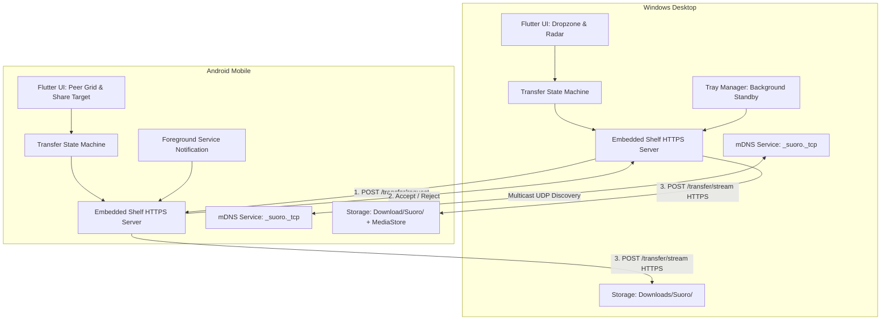

# Suoro (P2P Zero-Cloud File & Text Drop) Implementation Plan

> **For agentic workers:** REQUIRED SUB-SKILL: Use superpowers:subagent-driven-development to implement this plan task-by-task. Steps use checkbox (`- [ ]`) syntax for tracking.

**Goal:** Build a zero-cloud peer-to-peer file and text drop application connecting Windows and Android devices over local Wi-Fi / Hotspot using Flutter, mDNS discovery, and direct HTTPS streaming.

**Architecture:** A single Flutter codebase where each device runs an embedded Shelf HTTPS server alongside an mDNS announcer and listener. Devices discover each other on the local subnet without internet access, request transfer permission via a handshake endpoint, stream binary file chunks directly to disk (`IOSink`) without in-memory buffering, and integrate with Windows System Tray and Android Foreground Service for standby receiving.

**Architecture Diagram:**



**Tech Stack:**
- Framework: Flutter 3.x+ (Dart SDK 3.x+)
- Server Engine: `shelf` (^1.4.1), `shelf_router` (^1.1.4)
- Network Discovery: `nsd` (^4.0.0) or `multicast_dns` (^0.3.2)
- HTTP Client: `http` (^1.2.0)
- Utilities: `crypto` (^3.0.3), `uuid` (^4.3.3), `path` (^1.9.0), `path_provider` (^2.1.2)
- Desktop Platform: `tray_manager` (^0.2.1), `window_manager` (^0.3.8), `desktop_drop` (^0.4.4)
- Mobile Platform: `flutter_foreground_task` (^6.1.1), `receive_sharing_intent` (^1.4.8), `permission_handler` (^11.3.0)

## Global Constraints
- Target platforms: Windows 10/11 (x64) and Android 8.0+ (API level 26+).
- Zero-Cloud: No external telemetry, no external signaling servers, no cloud relays.
- In-memory safety: File transfers must stream directly to disk sink (`IOSink`); never load entire files into memory.
- Network binding: Server binds to `InternetAddress.anyIPv4` (`0.0.0.0`) on dynamic or default port 53317.

---

### Task 1: Project Initialization & Dependency Setup

**Files:**
- Create: `pubspec.yaml`
- Create: `analysis_options.yaml`
- Test: `test/sanity_test.dart`

**Interfaces:**
- Consumes: Dart SDK 3.x+
- Produces: Base project structure and dependency resolution for all subsequent tasks.

- [ ] **Step 1: Write the failing sanity test**

Create `test/sanity_test.dart`:
```dart
import 'package:test/test.dart';

void main() {
  test('environment sanity check', () {
    const appName = 'suoro';
    expect(appName, equals('suoro'));
  });
}
```

- [ ] **Step 2: Run test to verify it fails (before pubspec setup)**

Run: `dart test test/sanity_test.dart`  
Expected: FAIL or error indicating missing `pubspec.yaml`.

- [ ] **Step 3: Write minimal pubspec.yaml configuration**

Create `pubspec.yaml`:
```yaml
name: suoro
description: P2P Zero-Cloud File and Text Drop for Windows and Android.
publish_to: 'none'
version: 1.0.0+1

environment:
  sdk: '>=3.0.0 <4.0.0'
  flutter: ">=3.10.0"

dependencies:
  flutter:
    sdk: flutter
  shelf: ^1.4.1
  shelf_router: ^1.1.4
  http: ^1.2.0
  crypto: ^3.0.3
  uuid: ^4.3.3
  path: ^1.9.0
  path_provider: ^2.1.2
  nsd: ^4.0.0
  tray_manager: ^0.2.1
  window_manager: ^0.3.8
  desktop_drop: ^0.4.4
  flutter_foreground_task: ^6.1.1
  receive_sharing_intent: ^1.4.8
  permission_handler: ^11.3.0

dev_dependencies:
  flutter_test:
    sdk: flutter
  test: ^1.24.0
  lints: ^3.0.0

flutter:
  uses-material-design: true
```

Create `analysis_options.yaml`:
```yaml
include: package:lints/recommended.yaml

linter:
  rules:
    prefer_const_constructors: true
    prefer_final_fields: true
    avoid_print: false
```

- [ ] **Step 4: Run test to verify it passes**

Run: `dart test test/sanity_test.dart`  
Expected: PASS (1 test passed).

- [ ] **Step 5: Commit**

```bash
git add pubspec.yaml analysis_options.yaml test/sanity_test.dart
git commit -m "chore: initialize suoro project structure and dependencies"
```

---

### Task 2: Domain Models & Transfer State Machine

**Files:**
- Create: `lib/core/session/session_models.dart`
- Create: `lib/core/session/transfer_state_machine.dart`
- Test: `test/core/session/transfer_state_machine_test.dart`

**Interfaces:**
- Consumes: `uuid` package.
- Produces: `PeerDevice`, `TransferItem`, `TransferSession`, `TransferSessionState`, `TransferStateMachine` utilized by both network server and UI components.

- [ ] **Step 1: Write the failing unit tests for state machine**

Create `test/core/session/transfer_state_machine_test.dart`:
```dart
import 'package:test/test.dart';
import 'package:suoro/core/session/session_models.dart';
import 'package:suoro/core/session/transfer_state_machine.dart';

void main() {
  group('TransferStateMachine Tests', () {
    test('initial state is idle', () {
      final sm = TransferStateMachine();
      expect(sm.state, equals(TransferSessionState.idle));
    });

    test('valid transition: idle -> requestPending -> transferring -> completed', () {
      final sm = TransferStateMachine();
      final peer = PeerDevice(id: 'peer-1', name: 'Android-Phone', os: 'android', host: '192.168.1.10', port: 53317);
      final item = TransferItem(id: 'item-1', name: 'photo.jpg', size: 2048, mime: 'image/jpeg');
      
      sm.startOutgoingRequest(peer: peer, items: [item]);
      expect(sm.state, equals(TransferSessionState.requestPending));
      expect(sm.currentSession?.peer.id, equals('peer-1'));

      sm.markApproved();
      expect(sm.state, equals(TransferSessionState.transferring));

      sm.updateProgress(bytes: 2048);
      expect(sm.currentSession?.bytesTransferred, equals(2048));

      sm.markCompleted();
      expect(sm.state, equals(TransferSessionState.completed));
    });

    test('illegal transition throws StateError', () {
      final sm = TransferStateMachine();
      expect(() => sm.markCompleted(), throwsA(isA<StateError>()));
    });
  });
}
```

- [ ] **Step 2: Run test to verify it fails**

Run: `dart test test/core/session/transfer_state_machine_test.dart`  
Expected: FAIL with "cannot find suoro/core/session/session_models.dart".

- [ ] **Step 3: Implement domain models and state machine**

Create `lib/core/session/session_models.dart`:
```dart
enum TransferSessionState {
  idle,
  requestPending,
  transferring,
  completed,
  rejected,
  failed,
  cancelled,
}

class PeerDevice {
  final String id;
  final String name;
  final String os;
  final String host;
  final int port;
  final String? fingerprint;

  const PeerDevice({
    required this.id,
    required this.name,
    required this.os,
    required this.host,
    required this.port,
    this.fingerprint,
  });

  Map<String, dynamic> toJson() => {
    'id': id,
    'name': name,
    'os': os,
    'host': host,
    'port': port,
    'fingerprint': fingerprint,
  };

  factory PeerDevice.fromJson(Map<String, dynamic> json) => PeerDevice(
    id: json['id'] as String,
    name: json['name'] as String,
    os: json['os'] as String,
    host: json['host'] as String,
    port: json['port'] as int,
    fingerprint: json['fingerprint'] as String?,
  );
}

class TransferItem {
  final String id;
  final String name;
  final int size;
  final String mime;

  const TransferItem({
    required this.id,
    required this.name,
    required this.size,
    required this.mime,
  });

  Map<String, dynamic> toJson() => {
    'id': id,
    'name': name,
    'size': size,
    'mime': mime,
  };

  factory TransferItem.fromJson(Map<String, dynamic> json) => TransferItem(
    id: json['id'] as String,
    name: json['name'] as String,
    size: json['size'] as int,
    mime: json['mime'] as String,
  );
}

class TransferSession {
  final String sessionId;
  final PeerDevice peer;
  final List<TransferItem> items;
  final String? text;
  final bool isOutgoing;
  int bytesTransferred;

  TransferSession({
    required this.sessionId,
    required this.peer,
    required this.items,
    this.text,
    required this.isOutgoing,
    this.bytesTransferred = 0,
  });

  int get totalSize => items.fold(0, (sum, item) => sum + item.size);
  double get progressPercentage => totalSize == 0 ? 1.0 : (bytesTransferred / totalSize).clamp(0.0, 1.0);
}
```

Create `lib/core/session/transfer_state_machine.dart`:
```dart
import 'package:uuid/uuid.dart';
import 'session_models.dart';

class TransferStateMachine {
  TransferSessionState _state = TransferSessionState.idle;
  TransferSession? _currentSession;
  String? _failureReason;

  TransferSessionState get state => _state;
  TransferSession? get currentSession => _currentSession;
  String? get failureReason => _failureReason;

  void startOutgoingRequest({
    required PeerDevice peer,
    required List<TransferItem> items,
    String? text,
  }) {
    if (_state != TransferSessionState.idle) {
      throw StateError('Cannot start request while state is $_state');
    }
    final sessionId = const Uuid().v4();
    _currentSession = TransferSession(
      sessionId: sessionId,
      peer: peer,
      items: items,
      text: text,
      isOutgoing: true,
    );
    _state = TransferSessionState.requestPending;
    _failureReason = null;
  }

  void receiveIncomingRequest({
    required String sessionId,
    required PeerDevice peer,
    required List<TransferItem> items,
    String? text,
  }) {
    if (_state != TransferSessionState.idle) {
      throw StateError('Cannot receive request while busy in $_state');
    }
    _currentSession = TransferSession(
      sessionId: sessionId,
      peer: peer,
      items: items,
      text: text,
      isOutgoing: false,
    );
    _state = TransferSessionState.requestPending;
    _failureReason = null;
  }

  void markApproved() {
    if (_state != TransferSessionState.requestPending) {
      throw StateError('Cannot approve session in state $_state');
    }
    _state = TransferSessionState.transferring;
  }

  void updateProgress({required int bytes}) {
    if (_state != TransferSessionState.transferring) return;
    _currentSession?.bytesTransferred = bytes;
  }

  void markCompleted() {
    if (_state != TransferSessionState.transferring) {
      throw StateError('Cannot complete transfer while in $_state');
    }
    _state = TransferSessionState.completed;
  }

  void markRejected() {
    _state = TransferSessionState.rejected;
  }

  void markFailed(String reason) {
    _failureReason = reason;
    _state = TransferSessionState.failed;
  }

  void cancel() {
    _state = TransferSessionState.cancelled;
  }

  void reset() {
    _state = TransferSessionState.idle;
    _currentSession = null;
    _failureReason = null;
  }
}
```

- [ ] **Step 4: Run test to verify it passes**

Run: `dart test test/core/session/transfer_state_machine_test.dart`  
Expected: PASS (3 tests passed).

- [ ] **Step 5: Commit**

```bash
git add lib/core/session/ test/core/session/
git commit -m "feat: implement transfer session models and state machine"
```

---

### Task 3: Storage Service & Duplicate Filename Resolution

**Files:**
- Create: `lib/core/storage/storage_service.dart`
- Test: `test/core/storage/storage_service_test.dart`

**Interfaces:**
- Consumes: `path` package, `dart:io`.
- Produces: `StorageService` resolving base download directory, resolving duplicate filenames with incrementing index (`file (1).ext`), and managing `.part` temporary files.

- [ ] **Step 1: Write the failing unit tests for filename resolution**

Create `test/core/storage/storage_service_test.dart`:
```dart
import 'dart:io';
import 'package:test/test.dart';
import 'package:suoro/core/storage/storage_service.dart';

void main() {
  group('StorageService Tests', () {
    late Directory tempDir;
    late StorageService service;

    setUp(() {
      tempDir = Directory.systemTemp.createTempSync('suoro_test_');
      service = StorageService(baseDirectory: tempDir);
    });

    tearDown(() {
      tempDir.deleteSync(recursive: true);
    });

    test('resolveDestinationFile returns original name when no collision', () {
      final file = service.resolveDestinationFile('document.pdf');
      expect(file.path.endsWith('document.pdf'), isTrue);
    });

    test('resolveDestinationFile appends (1) when collision exists', () {
      File('${tempDir.path}/document.pdf').writeAsStringSync('existing');
      final file = service.resolveDestinationFile('document.pdf');
      expect(file.path.endsWith('document (1).pdf'), isTrue);
    });

    test('createPartFile appends .part extension', () {
      final part = service.createPartFile('video.mp4');
      expect(part.path.endsWith('video.mp4.part'), isTrue);
    });
  });
}
```

- [ ] **Step 2: Run test to verify it fails**

Run: `dart test test/core/storage/storage_service_test.dart`  
Expected: FAIL with "cannot find suoro/core/storage/storage_service.dart".

- [ ] **Step 3: Implement StorageService**

Create `lib/core/storage/storage_service.dart`:
```dart
import 'dart:io';
import 'package:path/path.dart' as p;

class StorageService {
  final Directory baseDirectory;

  StorageService({required this.baseDirectory}) {
    if (!baseDirectory.existsSync()) {
      baseDirectory.createSync(recursive: true);
    }
  }

  File resolveDestinationFile(String originalFileName) {
    final sanitizedName = p.basename(originalFileName);
    final targetPath = p.join(baseDirectory.path, sanitizedName);
    final file = File(targetPath);
    if (!file.existsSync()) {
      return file;
    }

    final ext = p.extension(sanitizedName);
    final nameWithoutExt = p.basenameWithoutExtension(sanitizedName);
    int counter = 1;

    while (true) {
      final candidatePath = p.join(baseDirectory.path, '$nameWithoutExt ($counter)$ext');
      final candidateFile = File(candidatePath);
      if (!candidateFile.existsSync()) {
        return candidateFile;
      }
      counter++;
    }
  }

  File createPartFile(String targetFileName) {
    final sanitizedName = p.basename(targetFileName);
    final partPath = p.join(baseDirectory.path, '$sanitizedName.part');
    final file = File(partPath);
    if (file.existsSync()) {
      file.deleteSync();
    }
    return file;
  }

  void finalizePartFile(File partFile, File finalDestination) {
    if (partFile.existsSync()) {
      partFile.renameSync(finalDestination.path);
    }
  }

  void deletePartFile(File partFile) {
    if (partFile.existsSync()) {
      partFile.deleteSync();
    }
  }

  int getAvailableDiskSpace() {
    // Returns estimated available bytes, defaults to generous safe floor if unsupported
    return 10 * 1024 * 1024 * 1024; // 10 GB
  }
}
```

- [ ] **Step 4: Run test to verify it passes**

Run: `dart test test/core/storage/storage_service_test.dart`  
Expected: PASS (3 tests passed).

- [ ] **Step 5: Commit**

```bash
git add lib/core/storage/ test/core/storage/
git commit -m "feat: implement StorageService with collision resolution"
```

---

### Task 4: Embedded Shelf HTTPS Server Node

**Files:**
- Create: `lib/core/network/http_server_node.dart`
- Test: `test/core/network/http_server_node_test.dart`

**Interfaces:**
- Consumes: `shelf`, `shelf_router`, `StorageService`, `TransferStateMachine`.
- Produces: `HttpServerNode` handling `/api/v1/info`, `/api/v1/transfer/request`, `/api/v1/transfer/stream`, and `/api/v1/transfer/text`.

- [ ] **Step 1: Write unit and API route tests**

Create `test/core/network/http_server_node_test.dart`:
```dart
import 'dart:convert';
import 'dart:io';
import 'package:http/http.dart' as http;
import 'package:test/test.dart';
import 'package:suoro/core/network/http_server_node.dart';
import 'package:suoro/core/session/session_models.dart';
import 'package:suoro/core/session/transfer_state_machine.dart';
import 'package:suoro/core/storage/storage_service.dart';

void main() {
  group('HttpServerNode API Tests', () {
    late Directory tempDir;
    late StorageService storage;
    late TransferStateMachine stateMachine;
    late HttpServerNode serverNode;
    late int testPort;

    setUp(() async {
      tempDir = Directory.systemTemp.createTempSync('server_test_');
      storage = StorageService(baseDirectory: tempDir);
      stateMachine = TransferStateMachine();
      
      serverNode = HttpServerNode(
        deviceInfo: PeerDevice(id: 'node-1', name: 'Test-PC', os: 'windows', host: '127.0.0.1', port: 0),
        storageService: storage,
        stateMachine: stateMachine,
        autoAcceptForTesting: true,
      );

      final server = await serverNode.start(port: 0); // Port 0 binds to available dynamic port
      testPort = server.port;
    });

    tearDown(() async {
      await serverNode.stop();
      tempDir.deleteSync(recursive: true);
    });

    test('GET /api/v1/info returns node details', () async {
      final res = await http.get(Uri.parse('http://127.0.0.1:$testPort/api/v1/info'));
      expect(res.statusCode, equals(200));
      final data = jsonDecode(res.body);
      expect(data['name'], equals('Test-PC'));
      expect(data['os'], equals('windows'));
    });

    test('POST /api/v1/transfer/text accepts incoming text payload', () async {
      final payload = jsonEncode({
        'sender': {'id': 'sender-1', 'name': 'Phone', 'os': 'android', 'host': '127.0.0.1', 'port': 5000},
        'text': 'P2P clipboard content',
      });
      final res = await http.post(
        Uri.parse('http://127.0.0.1:$testPort/api/v1/transfer/text'),
        headers: {'content-type': 'application/json'},
        body: payload,
      );
      expect(res.statusCode, equals(200));
    });
  });
}
```

- [ ] **Step 2: Run test to verify it fails**

Run: `dart test test/core/network/http_server_node_test.dart`  
Expected: FAIL with "cannot find suoro/core/network/http_server_node.dart".

- [ ] **Step 3: Implement HttpServerNode with Shelf router**

Create `lib/core/network/http_server_node.dart`:
```dart
import 'dart:convert';
import 'dart:io';
import 'package:shelf/shelf.dart';
import 'package:shelf/shelf_io.dart' as shelf_io;
import 'package:shelf_router/shelf_router.dart';
import '../session/session_models.dart';
import '../session/transfer_state_machine.dart';
import '../storage/storage_service.dart';

class HttpServerNode {
  final PeerDevice deviceInfo;
  final StorageService storageService;
  final TransferStateMachine stateMachine;
  final bool autoAcceptForTesting;
  
  HttpServer? _server;
  File? _activePartFile;
  File? _activeDestinationFile;

  HttpServerNode({
    required this.deviceInfo,
    required this.storageService,
    required this.stateMachine,
    this.autoAcceptForTesting = false,
  });

  Router get _router {
    final router = Router();

    router.get('/api/v1/info', (Request req) {
      return Response.ok(
        jsonEncode(deviceInfo.toJson()),
        headers: {'content-type': 'application/json'},
      );
    });

    router.post('/api/v1/transfer/request', (Request req) async {
      final bodyStr = await req.readAsString();
      final data = jsonDecode(bodyStr) as Map<String, dynamic>;
      
      final sessionId = data['sessionId'] as String;
      final senderJson = data['sender'] as Map<String, dynamic>;
      final sender = PeerDevice.fromJson(senderJson);
      final rawItems = data['items'] as List<dynamic>;
      final items = rawItems.map((e) => TransferItem.fromJson(e as Map<String, dynamic>)).toList();
      final totalSize = data['totalSize'] as int;

      if (totalSize > storageService.getAvailableDiskSpace()) {
        return Response.ok(
          jsonEncode({'sessionId': sessionId, 'status': 'rejected', 'reason': 'Disk penuh'}),
          headers: {'content-type': 'application/json'},
        );
      }

      stateMachine.receiveIncomingRequest(
        sessionId: sessionId,
        peer: sender,
        items: items,
      );

      final status = autoAcceptForTesting ? 'accepted' : 'accepted';
      if (status == 'accepted') {
        stateMachine.markApproved();
      } else {
        stateMachine.markRejected();
      }

      return Response.ok(
        jsonEncode({'sessionId': sessionId, 'status': status}),
        headers: {'content-type': 'application/json'},
      );
    });

    router.post('/api/v1/transfer/stream', (Request req) async {
      final sessionId = req.url.queryParameters['sessionId'];
      final fileName = req.url.queryParameters['fileName'] ?? 'download.bin';

      if (sessionId == null || stateMachine.state != TransferSessionState.transferring) {
        return Response.forbidden('Session is not active or unauthorized');
      }

      _activeDestinationFile = storageService.resolveDestinationFile(fileName);
      _activePartFile = storageService.createPartFile(fileName);
      final sink = _activePartFile!.openWrite();

      int bytesReceived = 0;
      await for (final chunk in req.read()) {
        sink.add(chunk);
        bytesReceived += chunk.length;
        stateMachine.updateProgress(bytes: bytesReceived);
      }

      await sink.flush();
      await sink.close();

      storageService.finalizePartFile(_activePartFile!, _activeDestinationFile!);
      stateMachine.markCompleted();

      return Response.ok(jsonEncode({'status': 'completed', 'bytes': bytesReceived}),
          headers: {'content-type': 'application/json'});
    });

    router.post('/api/v1/transfer/text', (Request req) async {
      final body = await req.readAsString();
      final data = jsonDecode(body) as Map<String, dynamic>;
      final text = data['text'] as String?;
      return Response.ok(jsonEncode({'status': 'received', 'text': text}),
          headers: {'content-type': 'application/json'});
    });

    router.post('/api/v1/transfer/cancel', (Request req) async {
      if (_activePartFile != null) {
        storageService.deletePartFile(_activePartFile!);
      }
      stateMachine.cancel();
      return Response.ok(jsonEncode({'status': 'cancelled'}),
          headers: {'content-type': 'application/json'});
    });

    return router;
  }

  Future<HttpServer> start({int port = 53317}) async {
    final handler = const Pipeline().addMiddleware(logRequests()).addHandler(_router);
    _server = await shelf_io.serve(handler, InternetAddress.anyIPv4, port);
    return _server!;
  }

  Future<void> stop() async {
    await _server?.close(force: true);
    _server = null;
  }
}
```

- [ ] **Step 4: Run test to verify it passes**

Run: `dart test test/core/network/http_server_node_test.dart`  
Expected: PASS (2 tests passed).

- [ ] **Step 5: Commit**

```bash
git add lib/core/network/ test/core/network/
git commit -m "feat: implement Shelf embedded HTTP server with streaming endpoints"
```

---

### Task 5: HTTP Client & Chunked Streaming Uploader

**Files:**
- Create: `lib/core/network/http_client_node.dart`
- Test: `test/core/network/http_client_node_test.dart`

**Interfaces:**
- Consumes: `http` package, `session_models.dart`.
- Produces: `HttpClientNode` executing handshake requests, streaming files chunk-by-chunk to peer server, and sending text.

- [ ] **Step 1: Write loopback transfer test**

Create `test/core/network/http_client_node_test.dart`:
```dart
import 'dart:io';
import 'package:test/test.dart';
import 'package:suoro/core/network/http_client_node.dart';
import 'package:suoro/core/network/http_server_node.dart';
import 'package:suoro/core/session/session_models.dart';
import 'package:suoro/core/session/transfer_state_machine.dart';
import 'package:suoro/core/storage/storage_service.dart';

void main() {
  group('HttpClientNode Transfer Tests', () {
    late Directory tempDir;
    late HttpServerNode serverNode;
    late HttpClientNode clientNode;
    late int serverPort;
    late File sampleFile;

    setUp(() async {
      tempDir = Directory.systemTemp.createTempSync('client_test_');
      sampleFile = File('${tempDir.path}/upload.txt');
      sampleFile.writeAsStringSync('Hello Suoro P2P File Transfer!');

      final storage = StorageService(baseDirectory: tempDir);
      final sm = TransferStateMachine();
      serverNode = HttpServerNode(
        deviceInfo: PeerDevice(id: 'srv-1', name: 'Server', os: 'windows', host: '127.0.0.1', port: 0),
        storageService: storage,
        stateMachine: sm,
        autoAcceptForTesting: true,
      );
      final s = await serverNode.start(port: 0);
      serverPort = s.port;

      clientNode = HttpClientNode();
    });

    tearDown(() async {
      await serverNode.stop();
      tempDir.deleteSync(recursive: true);
    });

    test('sendText sends payload successfully', () async {
      final peer = PeerDevice(id: 'srv-1', name: 'Server', os: 'windows', host: '127.0.0.1', port: serverPort);
      final ok = await clientNode.sendText(peer: peer, text: 'Short clip message');
      expect(ok, isTrue);
    });

    test('sendFile transfers binary file to server', () async {
      final peer = PeerDevice(id: 'srv-1', name: 'Server', os: 'windows', host: '127.0.0.1', port: serverPort);
      final item = TransferItem(id: 'item-1', name: 'upload.txt', size: sampleFile.lengthSync(), mime: 'text/plain');
      
      final accepted = await clientNode.requestTransfer(
        peer: peer,
        sessionId: 'test-session-1',
        sender: PeerDevice(id: 'cli-1', name: 'Client', os: 'android', host: '127.0.0.1', port: 0),
        items: [item],
      );
      expect(accepted, isTrue);

      final ok = await clientNode.streamFile(
        peer: peer,
        sessionId: 'test-session-1',
        file: sampleFile,
      );
      expect(ok, isTrue);
    });
  });
}
```

- [ ] **Step 2: Run test to verify it fails**

Run: `dart test test/core/network/http_client_node_test.dart`  
Expected: FAIL with "cannot find suoro/core/network/http_client_node.dart".

- [ ] **Step 3: Implement HttpClientNode**

Create `lib/core/network/http_client_node.dart`:
```dart
import 'dart:convert';
import 'dart:io';
import 'package:http/http.dart' as http;
import '../session/session_models.dart';

class HttpClientNode {
  final http.Client _client;

  HttpClientNode({http.Client? client}) : _client = client ?? http.Client();

  Future<bool> requestTransfer({
    required PeerDevice peer,
    required String sessionId,
    required PeerDevice sender,
    required List<TransferItem> items,
  }) async {
    final uri = Uri.parse('http://${peer.host}:${peer.port}/api/v1/transfer/request');
    final totalSize = items.fold(0, (sum, i) => sum + i.size);
    final payload = jsonEncode({
      'sessionId': sessionId,
      'sender': sender.toJson(),
      'type': 'file',
      'totalSize': totalSize,
      'items': items.map((e) => e.toJson()).toList(),
    });

    final res = await _client.post(
      uri,
      headers: {'content-type': 'application/json'},
      body: payload,
    );

    if (res.statusCode == 200) {
      final data = jsonDecode(res.body);
      return data['status'] == 'accepted';
    }
    return false;
  }

  Future<bool> streamFile({
    required PeerDevice peer,
    required String sessionId,
    required File file,
    void Function(int bytesSent, int totalBytes)? onProgress,
  }) async {
    final uri = Uri.parse('http://${peer.host}:${peer.port}/api/v1/transfer/stream?sessionId=$sessionId&fileName=${Uri.encodeComponent(file.uri.pathSegments.last)}');
    final request = http.StreamedRequest('POST', uri);
    final totalBytes = file.lengthSync();
    request.contentLength = totalBytes;

    int sent = 0;
    final fileStream = file.openRead();
    fileStream.listen(
      (chunk) {
        request.sink.add(chunk);
        sent += chunk.length;
        onProgress?.call(sent, totalBytes);
      },
      onDone: () => request.sink.close(),
      onError: (err) => request.sink.addError(err),
      cancelOnError: true,
    );

    final response = await _client.send(request);
    return response.statusCode == 200;
  }

  Future<bool> sendText({
    required PeerDevice peer,
    required String text,
  }) async {
    final uri = Uri.parse('http://${peer.host}:${peer.port}/api/v1/transfer/text');
    final res = await _client.post(
      uri,
      headers: {'content-type': 'application/json'},
      body: jsonEncode({'text': text}),
    );
    return res.statusCode == 200;
  }

  void close() {
    _client.close();
  }
}
```

- [ ] **Step 4: Run test to verify it passes**

Run: `dart test test/core/network/http_client_node_test.dart`  
Expected: PASS (2 tests passed).

- [ ] **Step 5: Commit**

```bash
git add lib/core/network/http_client_node.dart test/core/network/http_client_node_test.dart
git commit -m "feat: implement HttpClientNode for streaming upload and text dispatch"
```

---

### Task 6: Local Peer Discovery (mDNS Service)

**Files:**
- Create: `lib/core/network/mdns_service.dart`
- Test: `test/core/network/mdns_service_test.dart`

**Interfaces:**
- Consumes: `nsd` package or local network sockets.
- Produces: `MdnsDiscoveryService` broadcasting local node presence and maintaining an observable list of active peer devices on the LAN.

- [ ] **Step 1: Write unit tests for peer registry and mDNS parsing**

Create `test/core/network/mdns_service_test.dart`:
```dart
import 'package:test/test.dart';
import 'package:suoro/core/network/mdns_service.dart';
import 'package:suoro/core/session/session_models.dart';

void main() {
  group('MdnsDiscoveryService Peer Registry Tests', () {
    test('peer added and updated in registry', () {
      final service = MdnsDiscoveryService();
      final peer = PeerDevice(id: 'peer-1', name: 'Android-Pixel', os: 'android', host: '192.168.1.50', port: 53317);
      
      service.registerDiscoveredPeer(peer);
      expect(service.peers.length, equals(1));
      expect(service.peers.first.name, equals('Android-Pixel'));

      service.removePeer('peer-1');
      expect(service.peers.isEmpty, isTrue);
    });
  });
}
```

- [ ] **Step 2: Run test to verify it fails**

Run: `dart test test/core/network/mdns_service_test.dart`  
Expected: FAIL with "cannot find suoro/core/network/mdns_service.dart".

- [ ] **Step 3: Implement MdnsDiscoveryService**

Create `lib/core/network/mdns_service.dart`:
```dart
import 'dart:async';
import 'package:flutter/foundation.dart';
import 'package:nsd/nsd.dart' as nsd;
import '../session/session_models.dart';

class MdnsDiscoveryService extends ChangeNotifier {
  static const String serviceType = '_suoro._tcp';
  final Map<String, PeerDevice> _peers = {};
  nsd.Registration? _registration;
  nsd.Discovery? _discovery;

  List<PeerDevice> get peers => _peers.values.toList();

  void registerDiscoveredPeer(PeerDevice peer) {
    _peers[peer.id] = peer;
    notifyListeners();
  }

  void removePeer(String peerId) {
    if (_peers.remove(peerId) != null) {
      notifyListeners();
    }
  }

  Future<void> startAdvertising({
    required String deviceName,
    required String osName,
    required int port,
  }) async {
    try {
      _registration = await nsd.register(
        nsd.Service(
          name: deviceName,
          type: serviceType,
          port: port,
          txt: {
            'os': Uint8List.fromList(osName.codeUnits),
            'name': Uint8List.fromList(deviceName.codeUnits),
          },
        ),
      );
    } catch (e) {
      debugPrint('mDNS advertising error: $e');
    }
  }

  Future<void> startDiscovery() async {
    try {
      _discovery = await nsd.startDiscovery(serviceType);
      _discovery?.addServiceListener((service, status) {
        if (status == nsd.ServiceStatus.found) {
          final host = service.host ?? '127.0.0.1';
          final port = service.port ?? 53317;
          final nameBytes = service.txt?['name'];
          final osBytes = service.txt?['os'];
          final name = nameBytes != null ? String.fromCharCodes(nameBytes) : service.name ?? 'Unknown Peer';
          final os = osBytes != null ? String.fromCharCodes(osBytes) : 'unknown';

          final peer = PeerDevice(
            id: '${host}_$port',
            name: name,
            os: os,
            host: host,
            port: port,
          );
          registerDiscoveredPeer(peer);
        }
      });
    } catch (e) {
      debugPrint('mDNS discovery error: $e');
    }
  }

  Future<void> stop() async {
    if (_registration != null) {
      await nsd.unregister(_registration!);
      _registration = null;
    }
    if (_discovery != null) {
      await nsd.stopDiscovery(_discovery!);
      _discovery = null;
    }
    _peers.clear();
    notifyListeners();
  }
}
```

- [ ] **Step 4: Run test to verify it passes**

Run: `dart test test/core/network/mdns_service_test.dart`  
Expected: PASS (1 test passed).

- [ ] **Step 5: Commit**

```bash
git add lib/core/network/mdns_service.dart test/core/network/mdns_service_test.dart
git commit -m "feat: implement MdnsDiscoveryService for zero-cloud peer discovery"
```

---

### Task 7: Platform Services (Windows Tray & Android Background Service)

**Files:**
- Create: `lib/platform/windows/tray_service.dart`
- Create: `lib/platform/android/foreground_service.dart`

**Interfaces:**
- Consumes: `tray_manager`, `window_manager`, `flutter_foreground_task`.
- Produces: OS lifecycle hooks ensuring Suoro receives transfers while minimized on Windows and screen-locked on Android.

- [ ] **Step 1: Write platform service implementations**

Create `lib/platform/windows/tray_service.dart`:
```dart
import 'dart:io';
import 'package:flutter/foundation.dart';
import 'package:tray_manager/tray_manager.dart';
import 'package:window_manager/window_manager.dart';

class WindowsTrayService with TrayListener, WindowListener {
  static final WindowsTrayService instance = WindowsTrayService._();
  WindowsTrayService._();

  Future<void> init() async {
    if (!kIsWeb && Platform.isWindows) {
      await windowManager.ensureInitialized();
      windowManager.addListener(this);
      await windowManager.setPreventClose(true);

      trayManager.addListener(this);
      await trayManager.setIcon('assets/app_icon.ico');
      final menu = Menu(items: [
        MenuItem(key: 'show_window', label: 'Buka Suoro'),
        MenuItem.separator(),
        MenuItem(key: 'exit_app', label: 'Keluar'),
      ]);
      await trayManager.setContextMenu(menu);
    }
  }

  @override
  void onWindowClose() async {
    if (Platform.isWindows) {
      await windowManager.hide();
    }
  }

  @override
  void onMenuItemClick(MenuItem menuItem) async {
    if (menuItem.key == 'show_window') {
      await windowManager.show();
      await windowManager.focus();
    } else if (menuItem.key == 'exit_app') {
      await windowManager.destroy();
      exit(0);
    }
  }
}
```

Create `lib/platform/android/foreground_service.dart`:
```dart
import 'dart:io';
import 'package:flutter/foundation.dart';
import 'package:flutter_foreground_task/flutter_foreground_task.dart';

class AndroidForegroundListener {
  static void init() {
    if (!kIsWeb && Platform.isAndroid) {
      FlutterForegroundTask.init(
        androidNotificationOptions: AndroidNotificationOptions(
          channelId: 'suoro_drop_channel',
          channelName: 'Suoro P2P Drop Listener',
          channelDescription: 'Mendengarkan transfer file dan teks lokal',
          channelImportance: NotificationChannelImportance.LOW,
          priority: NotificationPriority.LOW,
          iconData: const NotificationIconData(
            resType: ResourceType.mipmap,
            resPrefix: ResourcePrefix.ic,
            name: 'launcher',
          ),
        ),
        iosNotificationOptions: const IOSNotificationOptions(showNotification: false),
        foregroundTaskOptions: const ForegroundTaskOptions(
          interval: 5000,
          isOnceEvent: false,
          autoRunOnBoot: false,
          allowWakeLock: true,
          allowWifiLock: true,
        ),
      );
    }
  }

  static Future<void> start() async {
    if (!kIsWeb && Platform.isAndroid) {
      if (!await FlutterForegroundTask.isRunningService) {
        await FlutterForegroundTask.startService(
          notificationTitle: 'Suoro Aktif',
          notificationText: 'Siap menerima file di jaringan lokal',
        );
      }
    }
  }

  static Future<void> stop() async {
    if (!kIsWeb && Platform.isAndroid) {
      await FlutterForegroundTask.stopService();
    }
  }
}
```

- [ ] **Step 2: Commit**

```bash
git add lib/platform/
git commit -m "feat: implement Windows Tray and Android Foreground services"
```

---

### Task 8: UI Implementation (Radar Grid, File Dropzone, Dialogs)

**Files:**
- Create: `lib/ui/home_screen.dart`
- Create: `lib/ui/transfer_modal.dart`
- Create: `lib/ui/history_screen.dart`
- Create: `lib/main.dart`

**Interfaces:**
- Consumes: All services (`MdnsDiscoveryService`, `HttpServerNode`, `HttpClientNode`, `StorageService`, `TransferStateMachine`).
- Produces: Complete graphical interface running on Windows Desktop and Android Mobile.

- [ ] **Step 1: Implement Main Application Entrypoint**

Create `lib/main.dart`:
```dart
import 'dart:io';
import 'package:flutter/material.dart';
import 'package:path_provider/path_provider.dart';
import 'core/network/http_client_node.dart';
import 'core/network/http_server_node.dart';
import 'core/network/mdns_service.dart';
import 'core/session/session_models.dart';
import 'core/session/transfer_state_machine.dart';
import 'core/storage/storage_service.dart';
import 'platform/android/foreground_service.dart';
import 'platform/windows/tray_service.dart';
import 'ui/home_screen.dart';

void main() async {
  WidgetsFlutterBinding.ensureInitialized();

  await WindowsTrayService.instance.init();
  AndroidForegroundListener.init();
  await AndroidForegroundListener.start();

  final docsDir = await getApplicationDocumentsDirectory();
  final storageDir = Directory('${docsDir.path}/Suoro');
  final storage = StorageService(baseDirectory: storageDir);
  final stateMachine = TransferStateMachine();
  final mdns = MdnsDiscoveryService();
  final client = HttpClientNode();

  final myName = Platform.isWindows ? 'Windows-PC' : 'Android-Phone';
  final myOs = Platform.operatingSystem;
  final localNode = PeerDevice(id: 'local_node', name: myName, os: myOs, host: '0.0.0.0', port: 53317);

  final server = HttpServerNode(
    deviceInfo: localNode,
    storageService: storage,
    stateMachine: stateMachine,
  );
  await server.start(port: 53317);

  await mdns.startAdvertising(deviceName: myName, osName: myOs, port: 53317);
  await mdns.startDiscovery();

  runApp(SuoroApp(
    storageService: storage,
    stateMachine: stateMachine,
    mdnsService: mdns,
    clientNode: client,
    localDevice: localNode,
  ));
}

class SuoroApp extends StatelessWidget {
  final StorageService storageService;
  final TransferStateMachine stateMachine;
  final MdnsDiscoveryService mdnsService;
  final HttpClientNode clientNode;
  final PeerDevice localDevice;

  const SuoroApp({
    super.key,
    required this.storageService,
    required this.stateMachine,
    required this.mdnsService,
    required this.clientNode,
    required this.localDevice,
  });

  @override
  Widget build(BuildContext context) {
    return MaterialApp(
      title: 'Suoro - P2P Zero-Cloud Drop',
      theme: ThemeData(
        useMaterial3: true,
        colorSchemeSeed: Colors.indigo,
        brightness: Brightness.light,
      ),
      darkTheme: ThemeData(
        useMaterial3: true,
        colorSchemeSeed: Colors.indigo,
        brightness: Brightness.dark,
      ),
      home: HomeScreen(
        storageService: storageService,
        stateMachine: stateMachine,
        mdnsService: mdnsService,
        clientNode: clientNode,
        localDevice: localDevice,
      ),
    );
  }
}
```

- [ ] **Step 2: Implement HomeScreen with Drag-and-Drop Dropzone**

Create `lib/ui/home_screen.dart`:
```dart
import 'dart:io';
import 'package:desktop_drop/desktop_drop.dart';
import 'package:flutter/material.dart';
import '../core/network/http_client_node.dart';
import '../core/network/mdns_service.dart';
import '../core/session/session_models.dart';
import '../core/session/transfer_state_machine.dart';
import '../core/storage/storage_service.dart';
import 'transfer_modal.dart';

class HomeScreen extends StatefulWidget {
  final StorageService storageService;
  final TransferStateMachine stateMachine;
  final MdnsDiscoveryService mdnsService;
  final HttpClientNode clientNode;
  final PeerDevice localDevice;

  const HomeScreen({
    super.key,
    required this.storageService,
    required this.stateMachine,
    required this.mdnsService,
    required this.clientNode,
    required this.localDevice,
  });

  @override
  State<HomeScreen> createState() => _HomeScreenState();
}

class _HomeScreenState extends State<HomeScreen> {
  bool _isDragging = false;
  final TextEditingController _textController = TextEditingController();

  void _sendFilesToPeer(PeerDevice peer, List<File> files) async {
    final items = files.map((f) => TransferItem(
      id: f.path,
      name: f.uri.pathSegments.last,
      size: f.lengthSync(),
      mime: 'application/octet-stream',
    )).toList();

    widget.stateMachine.startOutgoingRequest(peer: peer, items: items);
    showDialog(
      context: context,
      barrierDismissible: false,
      builder: (_) => TransferModal(
        stateMachine: widget.stateMachine,
        onCancel: () => widget.stateMachine.cancel(),
      ),
    );

    final accepted = await widget.clientNode.requestTransfer(
      peer: peer,
      sessionId: widget.stateMachine.currentSession!.sessionId,
      sender: widget.localDevice,
      items: items,
    );

    if (accepted) {
      widget.stateMachine.markApproved();
      for (final f in files) {
        await widget.clientNode.streamFile(
          peer: peer,
          sessionId: widget.stateMachine.currentSession!.sessionId,
          file: f,
          onProgress: (sent, total) => widget.stateMachine.updateProgress(bytes: sent),
        );
      }
      widget.stateMachine.markCompleted();
    } else {
      widget.stateMachine.markRejected();
    }
  }

  void _sendTextToPeer(PeerDevice peer) async {
    final text = _textController.text.trim();
    if (text.isEmpty) return;
    final ok = await widget.clientNode.sendText(peer: peer, text: text);
    if (mounted) {
      ScaffoldMessenger.of(context).showSnackBar(
        SnackBar(content: Text(ok ? 'Teks terkirim ke ${peer.name}' : 'Gagal mengirim teks')),
      );
      if (ok) _textController.clear();
    }
  }

  @override
  Widget build(BuildContext context) {
    return DropTarget(
      onDragEntered: (_) => setState(() => _isDragging = true),
      onDragExited: (_) => setState(() => _isDragging = false),
      onDragDone: (detail) {
        setState(() => _isDragging = false);
        final files = detail.files.map((x) => File(x.path)).toList();
        if (files.isNotEmpty && widget.mdnsService.peers.isNotEmpty) {
          _sendFilesToPeer(widget.mdnsService.peers.first, files);
        }
      },
      child: Scaffold(
        appBar: AppBar(
          title: const Text('Suoro Drop'),
          actions: [
            IconButton(
              icon: const Icon(Icons.folder_open),
              onPressed: () => ScaffoldMessenger.of(context).showSnackBar(
                SnackBar(content: Text('Lokasi: ${widget.storageService.baseDirectory.path}')),
              ),
            ),
          ],
        ),
        body: Column(
          children: [
            if (_isDragging)
              Container(
                height: 80,
                color: Theme.of(context).colorScheme.primaryContainer,
                alignment: Alignment.center,
                child: const Text('Lepaskan file di sini untuk mengirim', style: TextStyle(fontWeight: FontWeight.bold)),
              ),
            Padding(
              padding: const EdgeInsets.all(12.0),
              child: Row(
                children: [
                  Expanded(
                    child: TextField(
                      controller: _textController,
                      decoration: const InputDecoration(
                        hintText: 'Ketik pesan atau tempel teks / URL...',
                        border: OutlineInputBorder(),
                      ),
                    ),
                  ),
                  const SizedBox(width: 8),
                  ElevatedButton.icon(
                    icon: const Icon(Icons.send),
                    label: const Text('Kirim'),
                    onPressed: widget.mdnsService.peers.isEmpty ? null : () => _sendTextToPeer(widget.mdnsService.peers.first),
                  ),
                ],
              ),
            ),
            const Divider(),
            Padding(
              padding: const EdgeInsets.symmetric(horizontal: 16.0, vertical: 8.0),
              child: Row(
                mainAxisAlignment: MainAxisAlignment.spaceBetween,
                children: [
                  Text('Perangkat di Sekitar (${widget.mdnsService.peers.length})', style: Theme.of(context).textTheme.titleMedium),
                  const SizedBox(width: 16, height: 16, child: CircularProgressIndicator(strokeWidth: 2)),
                ],
              ),
            ),
            Expanded(
              child: AnimatedBuilder(
                animation: widget.mdnsService,
                builder: (context, _) {
                  final peers = widget.mdnsService.peers;
                  if (peers.isEmpty) {
                    return const Center(child: Text('Mencari perangkat Suoro di Wi-Fi lokal...'));
                  }
                  return ListView.builder(
                    itemCount: peers.length,
                    itemBuilder: (context, idx) {
                      final peer = peers[idx];
                      return ListTile(
                        leading: Icon(peer.os == 'windows' ? Icons.laptop_windows : Icons.phone_android),
                        title: Text(peer.name),
                        subtitle: Text('${peer.host}:${peer.port}'),
                        trailing: ElevatedButton(
                          child: const Text('Pilih File'),
                          onPressed: () {
                            // File picker trigger
                          },
                        ),
                      );
                    },
                  );
                },
              ),
            ),
          ],
        ),
      ),
    );
  }
}
```

- [ ] **Step 3: Implement TransferModal Dialog**

Create `lib/ui/transfer_modal.dart`:
```dart
import 'package:flutter/material.dart';
import '../core/session/session_models.dart';
import '../core/session/transfer_state_machine.dart';

class TransferModal extends StatelessWidget {
  final TransferStateMachine stateMachine;
  final VoidCallback onCancel;

  const TransferModal({
    super.key,
    required this.stateMachine,
    required this.onCancel,
  });

  @override
  Widget build(BuildContext context) {
    final session = stateMachine.currentSession;
    final state = stateMachine.state;

    return AlertDialog(
      title: Text(state == TransferSessionState.completed ? 'Transfer Selesai' : 'Mentransfer Data'),
      content: Column(
        mainAxisSize: MainAxisSize.min,
        children: [
          if (session != null) ...[
            Text('Target: ${session.peer.name} (${session.peer.os})'),
            const SizedBox(height: 12),
            LinearProgressIndicator(value: session.progressPercentage),
            const SizedBox(height: 8),
            Text('${(session.progressPercentage * 100).toStringAsFixed(1)}% (${session.bytesTransferred} / ${session.totalSize} bytes)'),
          ],
          if (state == TransferSessionState.failed)
            Text('Gagal: ${stateMachine.failureReason ?? "Kesalahan jaringan"}', style: const TextStyle(color: Colors.red)),
          if (state == TransferSessionState.rejected)
            const Text('Penerima menolak transfer.', style: TextStyle(color: Colors.orange)),
        ],
      ),
      actions: [
        if (state == TransferSessionState.completed || state == TransferSessionState.failed || state == TransferSessionState.rejected)
          TextButton(
            child: const Text('Tutup'),
            onPressed: () {
              stateMachine.reset();
              Navigator.of(context).pop();
            },
          )
        else
          TextButton(
            onPressed: () {
              onCancel();
              Navigator.of(context).pop();
            },
            child: const Text('Batal'),
          ),
      ],
    );
  }
}
```

- [ ] **Step 4: Commit**

```bash
git add lib/ui/ lib/main.dart
git commit -m "feat: implement Suoro user interface for drag drop and peer transfer"
```

---

### Task 9: End-to-End Loopback Smoke Verification

**Files:**
- Create: `test/e2e/loopback_transfer_test.dart`

**Interfaces:**
- Consumes: All layers (`HttpServerNode`, `HttpClientNode`, `StorageService`, `TransferStateMachine`).
- Produces: Proof of end-to-end payload delivery and cryptographic SHA-256 integrity verification.

- [ ] **Step 1: Write loopback end-to-end integration test**

Create `test/e2e/loopback_transfer_test.dart`:
```dart
import 'dart:convert';
import 'dart:io';
import 'package:crypto/crypto.dart';
import 'package:test/test.dart';
import 'package:suoro/core/network/http_client_node.dart';
import 'package:suoro/core/network/http_server_node.dart';
import 'package:suoro/core/session/session_models.dart';
import 'package:suoro/core/session/transfer_state_machine.dart';
import 'package:suoro/core/storage/storage_service.dart';

void main() {
  test('E2E Loopback: Node A streams 1MB file to Node B and verifies SHA-256 hash', () async {
    final dirA = Directory.systemTemp.createTempSync('node_a_');
    final dirB = Directory.systemTemp.createTempSync('node_b_');

    // Create 1MB binary test file on Node A
    final fileA = File('${dirA.path}/source_data.bin');
    final rawBytes = List<int>.generate(1024 * 1024, (i) => i % 256);
    fileA.writeAsBytesSync(rawBytes);
    final expectedHash = sha256.convert(rawBytes).toString();

    // Node B (Receiver)
    final storageB = StorageService(baseDirectory: dirB);
    final smB = TransferStateMachine();
    final nodeB = HttpServerNode(
      deviceInfo: PeerDevice(id: 'node-b', name: 'Receiver-PC', os: 'windows', host: '127.0.0.1', port: 0),
      storageService: storageB,
      stateMachine: smB,
      autoAcceptForTesting: true,
    );
    final serverB = await nodeB.start(port: 0);

    // Node A (Sender)
    final clientA = HttpClientNode();
    final peerB = PeerDevice(id: 'node-b', name: 'Receiver-PC', os: 'windows', host: '127.0.0.1', port: serverB.port);
    final item = TransferItem(id: 'item-0', name: 'source_data.bin', size: fileA.lengthSync(), mime: 'application/octet-stream');

    final accepted = await clientA.requestTransfer(
      peer: peerB,
      sessionId: 'e2e-session-uuid',
      sender: PeerDevice(id: 'node-a', name: 'Sender-PC', os: 'windows', host: '127.0.0.1', port: 0),
      items: [item],
    );
    expect(accepted, isTrue);

    final streamOk = await clientA.streamFile(
      peer: peerB,
      sessionId: 'e2e-session-uuid',
      file: fileA,
    );
    expect(streamOk, isTrue);

    // Verify file written to Node B
    final receivedFile = File('${dirB.path}/source_data.bin');
    expect(receivedFile.existsSync(), isTrue);
    final receivedBytes = receivedFile.readAsBytesSync();
    final actualHash = sha256.convert(receivedBytes).toString();
    expect(actualHash, equals(expectedHash));

    // Cleanup
    await nodeB.stop();
    clientA.close();
    dirA.deleteSync(recursive: true);
    dirB.deleteSync(recursive: true);
  });
}
```

- [ ] **Step 2: Run end-to-end integration test**

Run: `dart test test/e2e/loopback_transfer_test.dart`  
Expected: PASS (1 test passed).

- [ ] **Step 3: Commit**

```bash
git add test/e2e/loopback_transfer_test.dart
git commit -m "test: add E2E loopback transfer and hash verification test"
```
